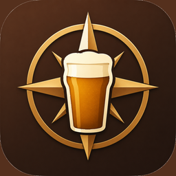
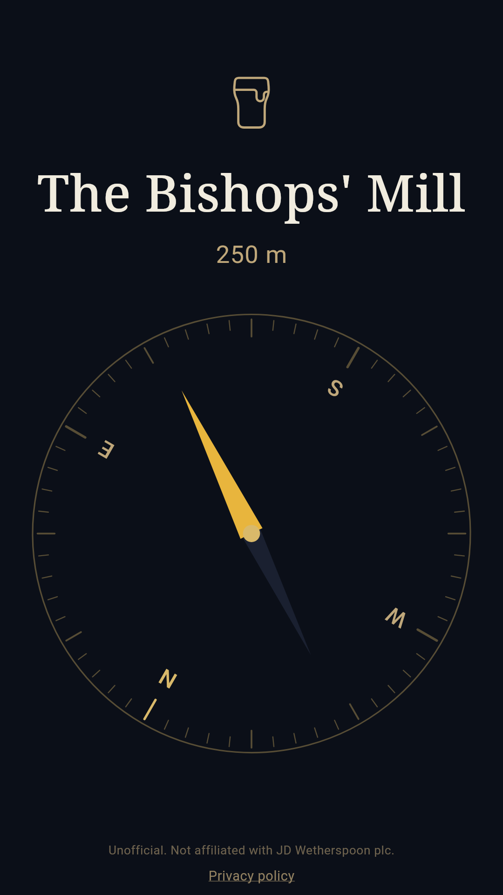
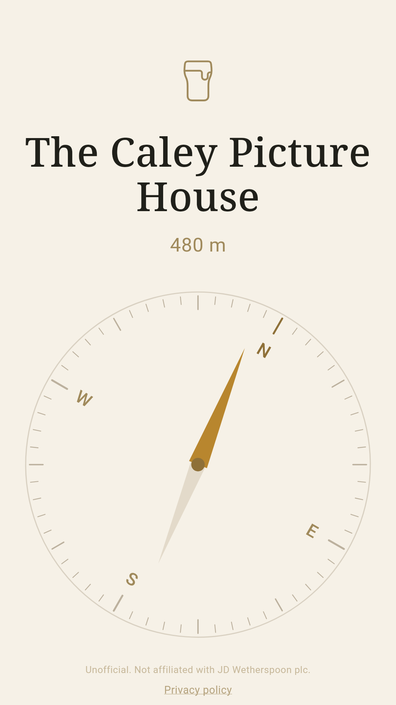

# Spoons Compass

A pocket compass that points to your nearest J D Wetherspoon pub, with the distance underneath. It works offline and keeps your location on your phone.

**[Website](https://cgarryZA.github.io/Spoons-Compass/)** · **[Join the Google Play beta](https://play.google.com/apps/testing/com.spoonscompass.spoons_compass)** · **[Privacy policy](https://cgarryZA.github.io/Spoons-Compass/privacy.html)**

 

This repository hosts the public website and privacy policy through GitHub Pages. The app's source code is private.

£0.99 on Google Play. iPhone coming soon.

> **Unofficial.** Not affiliated with, endorsed by, sponsored by, or in any way connected to J D Wetherspoon plc. "Wetherspoon" is a registered trademark of J D Wetherspoon plc.
